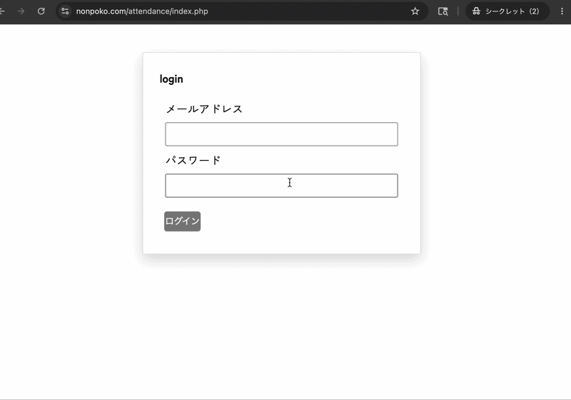
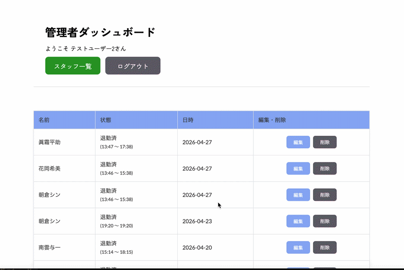
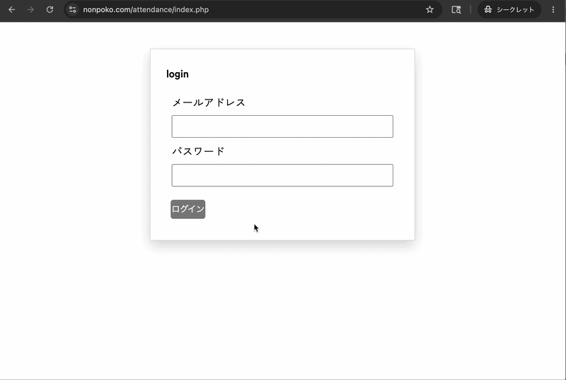

# 勤怠管理システム（Attendance Management App）　”Kintan”
## 概要
スタッフの利便性と管理者の視認性に特化した、シンプルで直感的な勤怠管理アプリケーションです。

**開発背景（プロダクトへの想い）**

前職の医療現場では、勤務管理がアナログな手法や古い慣習で行われており、管理者自身にとってもスタッフの勤務状況が視覚化されていないという課題がありました。 
「現場のスタッフは迷わずワンタップで記録でき、管理者は全スタッフの状況を一目で把握・修正できる」状態を目指し、実務での使いやすさを最優先に設計・開発しました。 
今回はその例を使用して、CRUD処理やデータ管理を学ぶためにこのアプリを作りました。 

**主な機能**　 
一般ユーザーができること： 
ログイン、ログアウト。出勤、退勤打刻ボタンのクリック（タップ）  
管理者（admin）ができること: 
ログイン、ログアウト。 
ユーザー打刻一覧表示、打刻内容編集・削除 
スタッフ新規登録、削除   

**使用技術**　　

PHP 8.x / MySQL / JavaScript / CSS (Flexbox) / XAMPP / GitHub Actions (CI/CD) / エックスサーバ 

## 実装画面
### 一般ユーザーの打刻画面と管理者画面

### ユーザーの打刻編集と削除

### ユーザー新規登録と削除

**こだわった点**　

### SQLによるデータ操作とDRY原則の徹底:
CRUD機能を網羅し、PDOを用いた安全なデータベース操作を実装。 
コードの重複を避けるため、共通処理をfunction.phpに集約し、保守性の高いコーディングを意識しました。 

### 実用的なUI/UX:
現場での利用を想定し、レスポンシブデザインを採用。 
どのデバイスからでも直感的に打刻できるレイアウトを目指しました。 
また、index.phpへのアクセスで即座にログイン画面へ誘導するなど、ユーザーの導線も改善しました。 

### 苦労したこと:
## 1.開発環境と本番環境の動的な切り替え
工夫した点: SetEnv（環境変数）を用いた接続情報の自動分岐 
ローカル環境（MAMP等）と本番環境（エックスサーバー）で、データベースの接続情報を手動で書き換える手間とミスを減らすため、 
.htaccess を活用した切り替え機能を実装しました。サーバー固有の設定に苦戦しましたが、一貫したデプロイフローを構築できたことで、開発効率と安全性が向上しました。 

## 2.セキュリティを重視したデータ設計
工夫した点: プリペアドステートメントによるSQLインジェクション対策 
外部からの不正な入力を防ぐため、PDOのプリペアドステートメントを徹底しました。 
単に「動く」コードではなく、ユーザーのデータを守るというエンジニアとしての責任を意識し、セキュリティ面でも堅牢な設計を目指しました。 

### 制作を通じて得た「エンジニアとしての視点」
これまではサービスを利用する「ユーザー」でしたが、開発者側に立つことで「この機能は本当に使いやすいか」「もし自分が管理者なら、どんな操作ミスをしそうか」といった一歩踏み込んだ視点を持つようになりました。  

具体例: 管理者画面での誤削除を防ぐための確認アラート（onsubmit）の実装や、誰が操作しても迷わないUI設計など、ユーザー目線を常に意識して試行錯誤を繰り返しました。 

**今後追加したい機能**
### 管理者用ダッシュボードの拡充:
スタッフ別・月別のフィルタリング機能の追加 
### データエクスポート機能:
給与計算ソフト等との連携を見据えた、勤怠データのCSV出力機能の実装。 

## ER図

## フロー図

